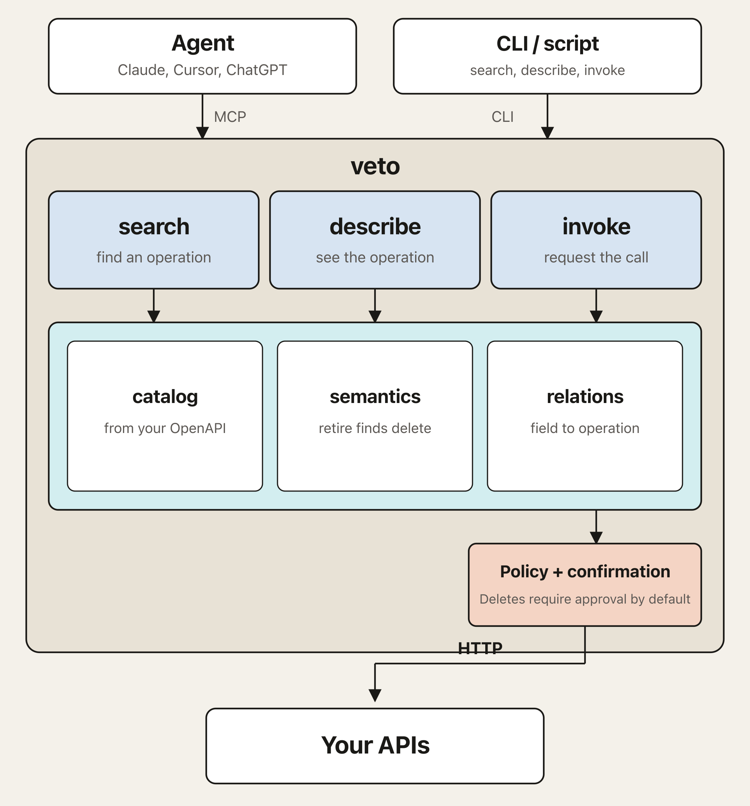

**Your whole API. Three tools.**

Stop turning every endpoint into another tool the agent has to carry.

Point veto at the OpenAPI you already have. Search finds the call. Describe shows the next one. Invoke runs it, or holds it until you approve that exact request.


The command, then what it means.

A hundred endpoints, or a thousand. The agent still gets search, describe, and invoke.

Ask who placed order 123. You declared that `Order.customerId` is `customers.get`, so the next call is named. The agent does not invent the link. A field name alone is not a call.

Ask to delete that order. The model can request it. The call waits until you approve that caller, that operation, and those parameters. Until then, nothing is sent.

```bash
brew install aiveto/veto/veto
```

```bash
veto init orders.yaml customers.yaml
veto serve --stdio
```

That is the whole start. The [setup guide](docs/guide.md#mcp) has the block for Claude, Cursor, or ChatGPT.

`go install github.com/aiveto/veto/cmd/veto@latest` needs Go 1.27.1. `brew` does not. Binaries are on [GitHub Releases](https://github.com/aiveto/veto/releases). A release also pushes `ghcr.io/aiveto/veto`.

Same catalog on MCP, on the CLI, and on `veto serve --json`. `veto generate` writes a Go client that calls the same runtime. Module `github.com/aiveto/veto`.

[veto-demo](https://github.com/aiveto/veto-demo) is the longer walk: Harbor, orders, customers, and billing. `make demo` runs it over the CLI, then over MCP.

Want it with no model key? This repo already runs the relation, the held delete, and the redacted trace.

```bash
git clone https://github.com/aiveto/veto.git
cd veto
go run ./examples/two-apis
```

```text
Someone asked who placed order 123.
orders.get returned customerId 7.
customers.get was called for 7 because the note said Order.customerId identifies customers.get.
orders.delete did not call HTTP until approved.
The trace left the secret out.
```

```bash
veto validate --config testdata/veto.yaml
veto serve --config testdata/veto.yaml --stdio
veto eval --config testdata/veto.yaml --case testdata/delete.yaml
```



**Pre-1.0.** Public APIs may change.

[Setup guide](docs/guide.md) | [Current limits](docs/guide.md#limits)
