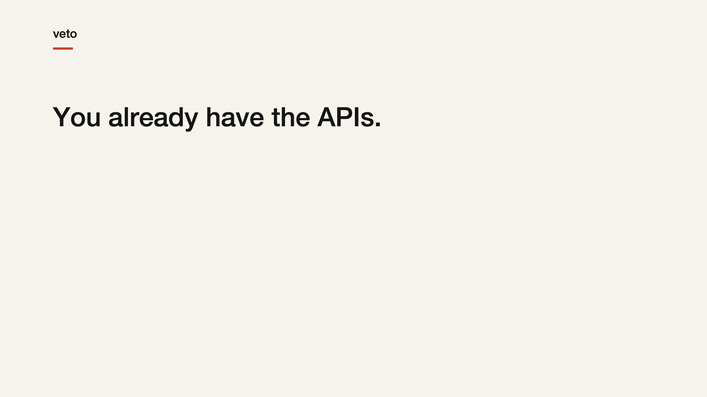

# Your entire API platform. Just 3 MCP tools.

Your APIs are already built. Make them agent-ready.

Turn existing OpenAPI services into intelligent, connected tools for AI agents, without building an MCP integration per endpoint.

3 MCP tools. Semantic discovery. Deterministic API relationships. CLI. Human approvals. All from one runtime.

No API rewrites. No hundreds of MCP tools. No separate integration for every service.



See it yourself: [Run the Harbor demo](https://github.com/aiveto/veto-demo) — explore connected APIs, follow relationships, and see approval-gated execution in action.

## 100 endpoints. 1,000 endpoints. Still 3 MCP tools.

### search → describe → invoke

- **Search.** Find the right API using natural language.
- **Describe.** Discover its schema and what to call next.
- **Invoke.** Execute it with built-in controls.

Your API catalog grows. Your agent's tool surface stays the same.

## Your APIs are connected. Your agents should know that.

Ask: "Who placed order 123?"

`orders.get` → customerId 7 → `customers.get`

Veto uses declared relationships to guide the next API call. No guessed endpoints. No invented relationships. No loading the entire API catalog into context.

## Agents can act. You stay in control.

Ask: "Delete order 123."

Veto holds the operation until a human approves the exact caller, operation, and parameters. When approval is required, the operation cannot proceed without it.

## One OpenAPI catalog. Multiple ways to use it.

| Want to... | Veto gives you |
| --- | --- |
| Connect AI agents | MCP server with 3 discovery tools |
| Explore APIs in your terminal | CLI |
| Build scripts and agent skills | JSON-line interface (`veto serve --json`) |
| Integrate with Go applications | A generated client for this runtime, not a new client per upstream API |
| Navigate across services | Semantic search and declared relationships |
| Safely execute sensitive operations | Human approvals and policy enforcement |
| Understand what executed | Redacted audit traces |

One catalog. One runtime. Consistent behavior across interfaces. Module `github.com/aiveto/veto`.

## Get started

Already have OpenAPI specs? You're three commands away from your first MCP server.

```bash
brew install aiveto/veto/veto
```

```bash
veto init orders.yaml customers.yaml
veto serve --stdio
```

The [setup guide](docs/guide.md#mcp) has the block for Claude, Cursor, or ChatGPT.

## See Veto in action

[Harbor](https://github.com/aiveto/veto-demo) is a working example: orders, customers, billing, declared relationships, and a delete that waits. `make demo` runs it over the CLI, then over MCP.

No model API key for the local example in this repo: `go run ./examples/two-apis`.

You already have the APIs. Give your agents a better way to use them.

[Get started](docs/guide.md) · [Try the demo](https://github.com/aiveto/veto-demo) · [Explore the source](https://github.com/aiveto/veto)
